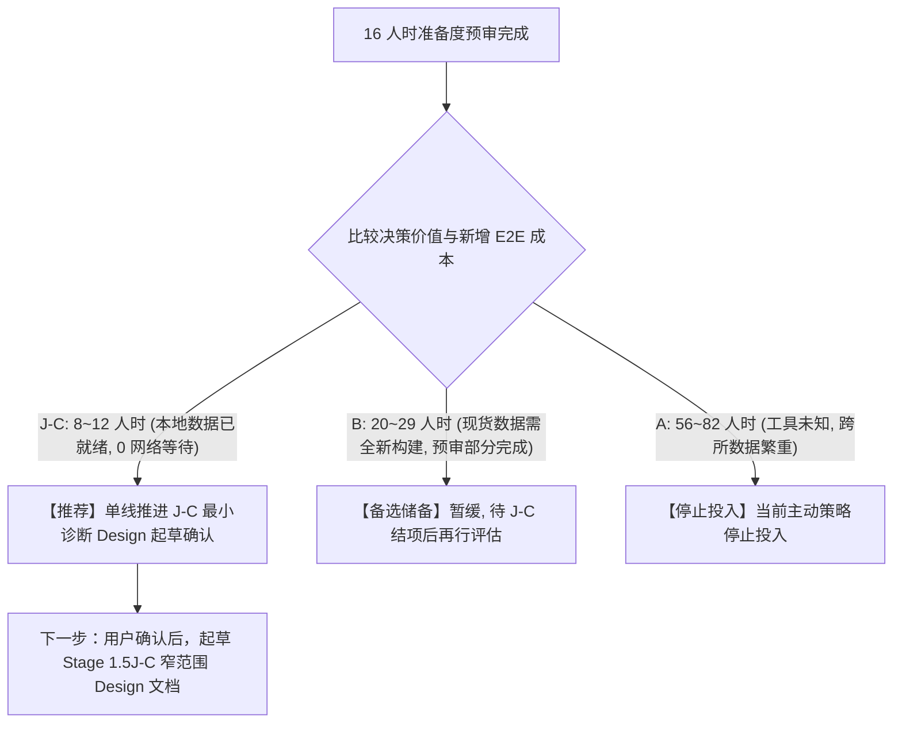

# 后续研究准备度预审报告

**日期：** 2026-10-23
**性质：** 依据用户授权与已审核基线文件执行的纯本地只读研究准备度预审报告；**不是 Design、Implementation Plan，不授予任何执行、交易或网络权限**。
**审核依据文档：** `docs/reviews/2026-10-23-next-research-readiness-decision-table_CN.md`
**审核依据 SHA-256：** `6b7e6f1f6391a89fbe6db0367791485542e80a998682bd14d717d1223ae51359`
**Git HEAD 基线：** `68b6fa0195b8c0687ec4aa68843402b186406884`（上一提交 `d79ea6b7c7868c370f496eb666c37ee6f863f001`）
**金融安全不变量：** `configs/base.py:RISK_LIVE_TRADING_ENABLED = False`（已执行断言验证）
**执行边界：** 严格遵循只读约束，0 网络请求、0 历史归档解压回放、0 源码及配置修改、0 交易信号。

---

## 执行摘要

本预审在 16 人时预算内，对 **J-C（新合约开盘时间与路径诊断）**、**B（新永续公告影响既有现货）**、**A（完整现货下架跨市场传导）** 三条候选路线完成了纯静态、本地化的数据、接口、证据与新增端到端（E2E）成本核对。

### 核心结论与选线建议

1. **综合评定建议：单线选择 J-C 进入小型 Design 讨论与起草确认。**
   - **核心理由：** J-C 所需的底层数据（280 个子合约原始 `aggTrades` ZIP 归档，`744 MB`）已全量保存在本地 Stage 1.5J-A replacement root 中。静态核查确认，全部 278 个有效锚点在 $[T_0, T_0 + 15\text{m}]$ 窗口内**跨午夜零点数量为 0**，日期包级覆盖率为 **100%**。从当前状态获取可复现结论的新增端到端成本仅需 **8 ~ 12 人时**（无需网络下载、无需外部开支），能以最小代价尽快检验该固定可行性场景是否存在物理参与空间，不代表优先 Alpha 潜力或预设否定结果。
2. **路线 B（备选储备，预审部分完成）：**
   - 本地拥有 131 篇公告详情原文与毫秒级 `publishDate`；71 个 `crypto` 标的仅为分类候选池（`candidate_taxonomy_pool = 71`），尚未核对公告时点是否存在 Binance Spot 交易对，且未冻结主要对照组。现货可买入资格当前判定为 `unknown`，做空渠道未核验，新增端到端成本约 **20 ~ 29 人时**。预审状态标注为 `precheck_partially_complete`，暂缓推进。
3. **路线 A（主动策略停止投入）：**
   - 本地无完整现货下架归档；历史工具证据当前属于未知/未核验（`historical_tool_evidence = unknown/unverified`）；Stage 1.6F 是期货下架的事后描述，不能等同于完整现货下架样本；新增端到端成本高达 **56 ~ 82 人时**。停止当前主动研究投入，不把缺记录等同于无工具或策略失败，不升级为 Risk-Veto。

---

## 一、 共同决策字段与跨路线横向比较表

每条路线统一按相同口径填写决策要素。新增端到端成本（`incremental_e2e_cost`）包含从当前状态拿到可复现收据的全部环节（Design、数据取证/准入、代码、测试、独立完成度审计、必要运行及结果复核），不计沉没成本：

| 决策字段 | J-C：新合约开盘时间与路径诊断 | B：新永续公告影响既有现货 | A：完整现货下架跨市场传导 |
| :--- | :--- | :--- | :--- |
| **`next_decisive_question`** （下一项证据决定什么） | 在首笔成交 60s 观察 + 3s 延迟后，新合约在剩余 15m 内是否存在扣除摩擦（50/80/150 bps）后仍有经济意义的价格上界（MFE），以及首次触及目标线与风险线的概率分布是否支持非对冲方向性策略？ | 新永续公告发布后，已存在现货市场在普通反应速度（公告后 5m）之后，是否存在区别于大盘非事件时段且能覆盖交易摩擦的持续性超额收益（动量或均值回归）？ | 币安宣布完整下架现货后，外部存续市场是否存在具有足够流动性且方向可做空的工具，使交易者知悉公告后能安全表达负向视图？ |
| **`incremental_e2e_cost`** （完整新增端到端成本） | **8 ~ 12 人时**（约 1 ~ 1.5 人日） - Design & Plan: 2~3 人时 - 归约实现与首次触及: 3~4 人时 - 单元/变异测试与 Rule 17 规范: 2~3 人时 - 运行与收据关闭审计: 1~2 人时 *(关键假设：复用 J-A 280 ZIP，0 外部支出，0 网络等待)* | **20 ~ 29 人时**（约 2.5 ~ 3.5 人日） - 现货历史行情准入与下载: 6~8 人时 - 微秒时间戳处理与对照组匹配: 8~12 人时 - 测试与 Rule 17 验证器: 4~6 人时 - 审计与收据关闭: 2~3 人时 *(关键假设：仅做同所现货；外部支出 $0)* | **56 ~ 82 人时**（约 7 ~ 10 人日） - 全网现货下架公告目录重构: 8~12 人时 - 外部市场工具与借币资格核查: 12~16 人时 - 跨所行情对齐与清洗: 16~24 人时 - 策略设计、测试与审计: 20~30 人时 *(关键假设：需对接外所多源数据)* |
| **`decision_if_supported`** （证据支持后改变什么） | 证明物理参与窗口存在：允许提出一套事先冻结的开盘微观结构策略假设（进入 Stage 1.5J-D 策略假设与事前特征匹配）。 | 证明 5m 延迟后仍有未被定价的信息肉：建立跨产品现货传导策略假设，进一步评估实盘可买入/可做空工具与滑点。 | 证明外部做空具有现实可行性：建立完整现货下架跨所传导策略假设（进入深入设计）。 |
| **`decision_if_not_supported`** （证据不支持后改变什么） | 停止该固定 J-C 可行性场景（60s 观察 + 3s 延迟 $\to$ 15m 终点）的后续投入，结论为 `scenario_not_supported` 或 `evidence_insufficient`；不泛化至未经检验的机制或规则。 | **否定 5m 延迟后跨产品传导假设**（证明已被秒级机器人吃尽），停止构建大型跨市场现货跟踪系统。 | 停止当前主动研究投入；记录为未知，不把缺记录等同于无工具或策略失败。 |
| **`decision_if_unknown`** （证据未知时改变什么） | 仅对流动性稀疏资产标记 `evidence_insufficient`，按主流流动性分层决定是否缩小策略适用域，不强行泛化。 | 若历史现货交易对映射或借币资格缺失：记录为 unknown，将 B 标注为 `precheck_partially_complete`，暂缓推进。 | 依据决策表规则**停止当前投入（Stop Investment）**，不将“无法证明有工具”臆想为“可用纸面价格做空盈利”，亦不推导风险否决规则。 |
| **专项边界 / 资格状态** | - `raw_coverage_known = qualified_date_package` (278/278 日期包完整) - `consumer_authority_pending = yes` - `new_reduction_required = yes` | - 价格可观察: `unknown_locally` (本地现货数据为 0) - 现货可买入: `unknown` (71 仅为分类候选池，未核验公告时点现货交易对映射) - 做空渠道可验证: `unverified` (历史借币深度不可查) - 预审状态: `precheck_partially_complete` | - 历史工具证据: `unknown/unverified` (本地无完整现货下架归档；外部借币与交易工具证据当前未核验) |
| **未决事实与复核入口** | 需要独立的 J-C consumer 授权设计与 15m 归约流式实现；AggTrades 不含盘口深度。入口：[J-A replacement manifest](../../data/external_signal_shadow/stage1_5j_a/historical_archive_coverage_inventory/stage1_5j_a_historical_archive_coverage_inventory_20261010T163500Z/manifest.json)。 | 71 个分类候选池中，公告时点具体哪些已存在 Binance Spot 现货对尚未核对；主要对照组未冻结。入口：[J-A raw article details](../../data/external_signal_shadow/stage1_5j_a/historical_archive_coverage_inventory/stage1_5j_a_historical_archive_coverage_inventory_20261010T163500Z/raw/article_details)。 | 完整现货下架真实事件分母与外部借币资格未查。入口：[Stage 1.6F W2-0 结论冻结 Delta](../designs/2026-09-26-external-signal-shadow-lab-stage1-6f-terminal-basis-conclusion-closure-delta-design_CN.md)。 |

---

## 二、 逐项工作包核查记录与证据细节

### 工作包 1：J-C 准备度核对（核查耗时：2.0 人时，预算上限：4 人时）

1. **输入与物理归档核查（[E1]）**：
   - 目标路径：`data/external_signal_shadow/stage1_5j_a/historical_archive_coverage_inventory/stage1_5j_a_historical_archive_coverage_inventory_20261010T163500Z/raw/archive`
   - 物理文件核实：目录下真实存在 **280 个 `.zip` 归档文件** 与 **280 个同名 `.CHECKSUM` 文件**（经 `os.walk` 验证，无软链接，无路径逃逸）。
   - 对应已准入收据：J-B 生产收据（`20261014T044500Z/summary.json`）记录 281 个子标的中，278 个为 `anchor_found`，2 个为 `inherited_j_a_parent_gap`（AIAUSDT 及其同公告标的），1 个为 `anchor_delay_exceeded`（BRKBUSDT）。
2. **三项消费边界状态判定**：
   - **`raw_coverage_known`（包级覆盖已知度）**：
     - 读取 J-B `summary.json` 中 278 个 `anchor_found` 标的的 `anchor_time_ms` 与 $T_0 + 900,000\text{ ms}$（15 分钟终点）。
     - **核查事实：全部 278 个有效标的在 15 分钟窗口内，起止时间戳转换后的 UTC 日期严格相同，跨午夜零点数量为 0**。
     - 判定：针对 15m 窗口所需的日期包，本地 J-A raw archive 提供了 **100% 的单日包级覆盖**。
     - 限制记录：包级覆盖不代表包内成交级连续；需待流式归约确认 $T_0 + 63\text{s}$ 及 $T_0 + 15\text{m}$ 附近是否存在满足条件的成交记录。
   - **`consumer_authority_pending = yes`（消费授权待定）**：
     - 检查 `stage1_5j_a_historical_archive_coverage_inventory.py` 与 `stage1_5j_b_historical_aggtrades_launch_response.py`，现有模块均未定义面向 Stage 1.5J-C 的下游 consumer 准入凭证。
     - J-C 必须作为独立 consumer 设计权威绑定，不得以脚本形式直接无凭证透传引用内部私有逻辑。
   - **`new_reduction_required = yes`（新归约必需度）**：
     - J-B 收据只计算了固定 $5\text{m} / 1\text{h} / 4\text{h}$ 的终点价格与收益率，未记录 $T_0 + 63\text{s}$ 的买入参考价、未记录 $[T_0+63\text{s}, T_0+15\text{m}]$ 期间的最高/最低价（MFE/MAE），未计算止盈止损线首次触及顺序。J-C 必须执行新的流式归约。
3. **接口复用与实现缺口**：
   - 可复用接口：`stage1_5j_b_historical_aggtrades_launch_response.py` 中的 `_ChunkBoundedReader`（流式内存截断读取器，已通过 65KB 边界变异测试）与 `admit_upstream_j_a_root`。
   - 待实现缺口：单 pass 维护 $[T_0+63\text{s}, T_0+15\text{m}]$ 窗口的最高/最低价更新、按预设 $(target\_bps, stop\_bps)$ 矩阵做首次触及状态机判断。

---

### 工作包 2：路线 B 来源与资格核对（核查耗时：2.5 人时，预算上限：6 人时）

1. **事件与时间依据核对**：
   - 目标路径：`data/external_signal_shadow/stage1_5j_a/historical_archive_coverage_inventory/stage1_5j_a_historical_archive_coverage_inventory_20261010T163500Z/raw/article_details`
   - 物理文件核实：本地真实存在 **131 个公告详情 `.json` 文件**。
   - 时间戳核实：抽样与全量检查表明，131 篇公告详情全部包含毫秒级整数 `data.publishDate`（例如 `1774015109010`），为公告官方发布时间提供了确定性基准。
2. **候选资产与目标市场选定**：
   - 按照决策表“优先考察同所既有现货，不强建跨所管道”原则，目标市场选定为 **Binance Spot（币安现货）**。
   - 检查 `stage1_5j_token_launch_classification_ledger_v2.csv`：在 281 个上线合约中，资产类别分布为：`equity: 171`, `crypto: 71`, `etf: 31`, `commodity: 7`, `unknown: 1`。
   - 分类候选池界定：剔除美股/ETF/大宗代币后，crypto 分类候选池共有 71 个标的（`candidate_taxonomy_pool = 71`）。需特别指明：这 71 个标的仅来自合约上线分类账本，尚未完成公告时点的 Binance Spot 交易对映射核查。
3. **三类方向资格客观核查**：
   - **价格可观察性（Price Observability）**：
     - 币安公开数据平台（`data.binance.vision`）提供了日度现货 `aggTrades` 与 `klines`。
     - **本地现状：本地磁盘存储的现货历史归档为 0 字节**。若要分析，必须新建现货下载、校验与时间戳适配（2025 年起现货为微秒时间戳）管道。
   - **现货可买入资格（Spot Buyability）**：
     - 状态判定为 **`unknown`**。
     - 目前尚未核验这 71 个加密标的中具体有哪些在 `publishDate` 之前已在币安现货正常开通交易，亦未冻结主要对照组（Primary Matched Control），故现货可买入资格当前无法判定为合格。
   - **做空渠道可验证性（Shortability Channel Verifiability）**：
     - 状态判定为 **`unverified`**。
     - 在现货市场做空必须依赖杠杆借币（Margin Borrow）。币安官方不提供历史每日杠杆借币池剩余可借额度（Borrow Quota）或借币利率跳增记录。无法证明在公告发布当下，普通交易者能以正常费率借到现货完成卖出。做空方向无法声称具备可执行性。
4. **工作包判定**：
   - 路线 B 预审状态记录为 **`precheck_partially_complete`**（现货对映射与主要对照组未闭环）。

---

### 工作包 3：路线 A 证据来源核对（核查耗时：1.0 人时，预算上限：2 人时）

1. **既有历史证据边界核对（[E3]）**：
   - 核对 `docs/designs/2026-09-26-external-signal-shadow-lab-stage1-6f-terminal-basis-conclusion-closure-delta-design_CN.md` 与 Stage 1.6F 审查报告。
   - Stage 1.6 封存的 41 标的 / 27 父事件分母全部为 **币安永续合约下架（Futures Delisting）**，其研究属性严格为事后探索性描述（`exploratory_described`），核心实证包括：
     - 公告后 4h 最大暴涨达 $+157.38\%$，盘口深度最低跌至 $5.99\text{ USDT}$；
     - 交割前 24h 绝对基差非但不收敛，反而有 16/19 个父事件绝对基差扩大（中位数扩大 $+102.56\text{ bps}$）。
   - 约束判定：Stage 1.6F 是期货下架的事后描述，不能等同于完整现货下架样本；W1/W2-0 事实禁止升级为方向策略、执行结论或风险规则（包含 Risk-Veto）。
2. **完整现货下架（Full Spot Delisting）资料核对**：
   - 本地现状：工作区内**没有任何完整现货下架的公告目录、收据或行情数据**。
   - 外部可借币与退出证据：历史借币池配额与外部交易工具证据当前未核验。
   - 判定：历史工具证据当前属于 **未知/未核验（`historical_tool_evidence = unknown/unverified`）**。根据决策表规则，记录为未知并停止当前主动研究投入，不把缺记录等同于无工具或策略失败，亦不推导风险否决规则。

---

## 三、 选线与最终推进建议

依据决策表“汇总与单线选择”规则，对比三条路线的决策价值与新增端到端成本：

### 推荐决定：单线推进 Stage 1.5J-C 窄范围 Design 讨论与起草确认

- **工作包范围**：
  1. 严格限定在本地已存在的 280 个 J-A 归档与 J-B 锚点元数据内；
  2. 预注册场景：$T_0 + 60\text{s}$ 观察 $+ 3\text{s}$ 延迟，终点为 $T_0 + 15\text{m}$，往返成本 $50 / 80 / 150\text{ bps}$；
  3. 双输出结构：物理极大移动空间（MFE/MAE 分布）与首次触及状态机（预设固定目标与止损线）；
  4. 分层隔离：Pre-Market 与 Standard Crypto 严格分列报告。
- **不扩张范围**：不写通用撮合器、不建特征工程库、不开展事后参数优化。
- **权限声明**：本预审报告本身不授权实现、数据消费、网络、交易或运行操作；起草 Design 需用户另行确认。
