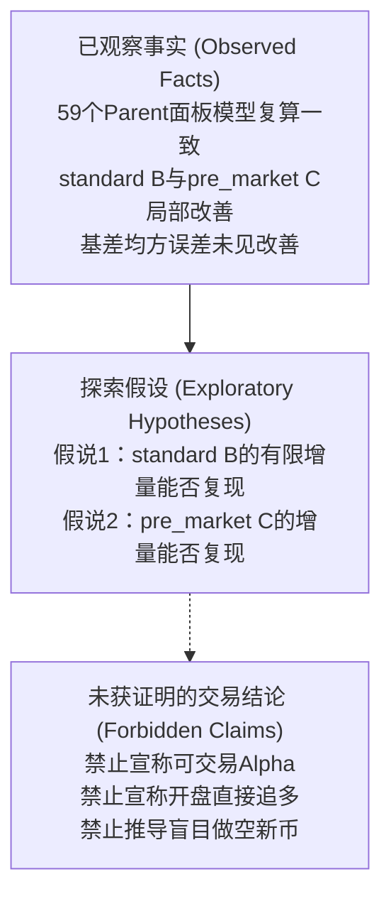

# 新合约价格状态与 OI／基差增量信息探索研究总结

**文档状态：** `research_summary / post_audit_closure / no_alpha_claim`  
**基准日期：** 2026-11-06  
**对应设计：** `docs/designs/2026-11-04-launch-price-oi-basis-incremental-information-exploratory-design_CN.md` (SHA-256: `f38fd9c4609a52cc9d2d6529cceabca35c778e84c374fad4e386029d0493519e`)  
**对应计划：** `docs/plans/2026-11-04-launch-price-oi-basis-incremental-information-exploratory-implementation-plan_CN.md` (SHA-256: `fe8dc877323f91725773502eaf606822350f47ed703fc484c5d199e5265fda6f`)  
**输入产物：** `/private/tmp/launch_incremental_run_20261105/` 目录下 `parent_panel.csv`、`fold_diagnostics.csv`、`review_CN.md`  
**权限说明：** 本文档仅为事后独立复核与总结，不授权任何联网、数据重新下载、重新拟合、测试网/实盘交易、信号生成或 Git 提交操作；`configs.base.RISK_LIVE_TRADING_ENABLED` 严格保持为 `False`。

---

## 1. 独立复核概述

Model A 采用独立 QR 求解器对 `/private/tmp/launch_incremental_run_20261105/` 输出的 Parent 面板与全部 259 条留一折（LOPO）记录进行了全量重算复核：
- **数值与计算核验**：独立求解与落盘预测的最大绝对差异约为 $1.9 \times 10^{-8}$，与面板及结果的写出精度相符。这支持本批数据在固定模型下的计算一致性，不等于证明全部代码、原始数据来源或真实 PIT 均已验证；本次复核未重新消费上游快照或重放原始数据；
- **解读纠偏**：Model C 初版执行摘要存在“以偏概全、将中位数等同于期望、编造暴涨币标签、忽略正向探索线索、将模型数学失稳误认为市场真相”等过度推断。本文依据独立复核意见，完成事实校正与三层边界划分。

---

## 2. 本批输出的统计结果

### 2.1 样本分母与观测口径
- **Parent 统计单位**：候选 Parent 60 篇，实际完整 Parent 59 篇（`standard` 41 篇完整、1 篇缺失锚点；`pre_market` 18 篇全完整）。Parent 去重不等于证明不同日期或机制之间不存在共同市场相关性；
- **259 条折记录性质**：系 59 个完整 Parent 在 2 个上市机制、3 种时间假设情景（A/B/C）与 2 类模型对决（$M_1$ vs $M_0$、$M_2$ vs $M_1$）下的组合评估记录，**绝非 259 个独立市场样本**；
- **时间观察点**：所有情景的参考观察时点固定在 $D = T_0 + 25\text{m}$，参考入场取 `[D,D+5s]` 首笔成交，目标为该成交后 15 分钟的终点收益 $y$（`terminal_return`），不代表实际下单。A/B/C 的总假定可用余量为 5/10/15 分钟，因此最新 OI 标签 $L_1$ 的上界分别为 $T_0+20\text{m}$、$T_0+15\text{m}$、$T_0+10\text{m}$；实际选择不晚于上界的最新五分钟网格记录，$L_0=L_1-5\text{m}$，不保证恰好落在上述相对时刻。真实信息截止时间及实时可得性仍未验证。

### 2.2 全量模型比较与误差变动矩阵

约定：$d_i = \text{error}_{\text{base}, i}^2 - \text{error}_{\text{extended}, i}^2$；均方误差（MSE）相对改善计算为 $\frac{\text{MSE}_{\text{base}} - \text{MSE}_{\text{ext}}}{\text{MSE}_{\text{base}}}$。改善指统计拟合误差下降，不等于交易盈亏。

| 上市机制 | 情景 / 增量模型 | 样本集 (Cohort) | 可用 Parent | MSE 相对改善 | Parent 改善/恶化数量 | 中位绝对误差(基准) | 中位绝对误差(扩展) | 固定折贡献剔除区间 |
|---|---|---|---|---|---|---|---|---|
| **standard** | A：加入 OI ($M_1$ vs $M_0$) | oi_complete | 41 | **-6.85%** | 15 改善 / 26 恶化 | 2.91% | 2.81% | [-0.000241, -0.000154] |
| **standard** | **B：加入 OI ($M_1$ vs $M_0$)** | **oi_complete** | **41** | **+4.71%** | **21 改善 / 20 恶化** | **2.91%** | **2.98%** | **[+0.000041, +0.000217]** |
| **standard** | C：加入 OI ($M_1$ vs $M_0$) | oi_complete | 41 | **-26.95%** | 21 改善 / 20 恶化 | 2.91% | 3.01% | [-0.000999, -0.000057] |
| **standard** | **B：再加基差 ($M_2$ vs $M_1$)** | **basis_complete** | **41** | **-0.91%** | **22 改善 / 19 恶化** | **2.98%** | **2.79%** | **[-0.000046, +0.000031]** |
| **pre_market** | A：加入 OI ($M_1$ vs $M_0$) | oi_complete | 18 | **-1434.83%** | 12 改善 / 6 恶化 | 5.14% | 5.34% | [-0.093252, -0.000855] |
| **pre_market** | B：加入 OI ($M_1$ vs $M_0$) | oi_complete | 18 | **-6.74%** | 10 改善 / 8 恶化 | 5.14% | 5.38% | [-0.000793, +0.000661] |
| **pre_market** | **C：加入 OI ($M_1$ vs $M_0$)** | **oi_complete** | **18** | **+47.94%** | **11 改善 / 7 恶化** | **5.14%** | **4.32%** | **[+0.001510, +0.003322]** |
| **pre_market** | B：基差模型 ($M_1/M_2$) | basis_complete | 0 | `evidence_insufficient` | N/A | N/A | N/A | N/A |

改善/恶化数量按各折 $d_i>0$ / $d_i<0$ 计数。最后一列仅逐一剔除已经计算的贡献并重算其余贡献均值，不重新训练；不是重新拟合的 Jackknife、置信区间或显著性检验。LOPO 仅为已观察历史上的内部模型检查，训练折可以含较晚日期，不能解释为前瞻预测。

---

## 3. 执行摘要错误解释修正

针对初版报告中出现的关键理解偏差，修正如下：

### 修正 1：“大多数样本变差”不成立
- **事实错误**：初版根据 standard B 总体中位绝对误差从 2.91% 上升至 2.98%，直接断言“绝大多数样本加入 OI 后表现更差”；
- **统计纠偏**：两组分布的中位数差不等于各样本误差变化量的中位数。在 standard B 实际 41 个 Parent 中，**有 21 个样本误差改善、20 个样本变差（改善数量略占多数）**；在再加入基差的 $M_2$ vs $M_1$ 中，**有 22 个样本改善、19 个变差**。因此，“全面劣于纯价格”、“绝大多数变差”属于统计推断错误。

### 修正 2：“改善全靠两只暴涨妖币”存在具体事实错误
- **事实错误**：初版将贡献最大的两只币统称为“暴涨妖币”；
- **真实数据**：
  - 排名第 1 的 `741ea1c9...`（`GENIUSUSDT`）：实际终点收益 $y = \mathbf{-6.74\%}$，基准模型 $M_0$ 预测接近 0，扩展模型 $M_1$ 预测为 -7.54%，更接近实际下跌；
  - 排名第 2 的 `63341635...`（`BASEDUSDT`）：实际终点收益 $y = \mathbf{+9.86\%}$，扩展模型预测约 -0.10%，虽缩小了下偏，但仍未预测为上涨；
- **集中度定性**：两项贡献合计约 0.00853613，超过全部 41 项净贡献之和 0.00602855；同时剔除这两项固定贡献后，剩余 39 项平均 $d_i = -0.00006430$。若逐一只剔除一个固定贡献，均值范围为 `[+0.000041, +0.000217]`，均为正。这说明改善集中，但不是“两只暴涨币”或已证实的幸存者偏差，也不证明未来稳健性；没有对删除事件后的训练集重新拟合。

### 修正 3：补齐被遗漏的盘前情景 C 正向探索结果
- **遗漏纠偏**：初版未报告 `pre_market` 情景 C 的正向探索结果；
- **客观事实**：情景 C 使用不晚于开盘后 $T_0+10\text{m}$ 的最新 OI 标签与其五分钟前驱计算变化，不是开盘前数据，也不是最初十分钟累计 OI。该情景 MSE 下降 **47.94%**，中位绝对误差从 5.14% 降至 4.32%，固定折贡献剔除区间全部为正。它是有待后续独立样本检验的线索，未经显著性检验，不能替换旧研究的主情景 B 或晋级为可交易 Alpha。

### 修正 4：盘前情景 A 的严重误差主要来自单折外推
- **观察事实**：在 `pre_market` A 中，`15676079...`（`KITEUSDT`）真实收益为 +17.94%，仅有 17 个训练 Parent 的无约束 OLS 交互模型输出了 **-108.77%** 的极端预测。该折 $d_i \approx -1.565$，约占该情景净平方误差恶化的 99.1%；这不是实际市场跌幅，也未单独识别过拟合、共线性等因素各自的作用；
- **统计纠偏**：除该失稳折外，其余 17 折有 12 折改善，不能由总 MSE 恶化推断所有样本或所有 OI 用法均失效。保留该折，不以删点、截断或改模型来美化本轮结果。

### 修正 5：“中位数负收益”不能推出负期望或做空优势
- **样本反例**：在 `pre_market` 样本中，中位数为 -1.45%，但均值为 +1.47%；在 `standard` 中，中位数为 -1.39%，均值为 -0.48%。样本中位数不等于样本均值，二者均不能直接等同于未来净收益期望；
- **未测风险与成本**：样本相对参考入场价的盘中上行极值曾约为 21%~23%，表明做空可能面临不利路径；是否导致爆仓取决于杠杆、保证金和风控，不能由本报告断言。本研究没有定义或回测做空策略，也未测量其费用、滑点、资金费率或借币成本，不能推导“转做空更有优势”。

---

## 4. 三层边界清晰划分

根据 `L2_Alpha_Research_Methodology.md`，严密区分以下三个层次：

### 4.1 已观察事实（Observed Facts）
1. 以 59 个完整 Parent 的已生成面板复算固定模型，结果与落盘折记录在写出精度附近一致；这不是从原始数据起的完整链路复验；
2. 在 `standard` 机制的主情景 B 中，加入 OI 使全样本 MSE 改善 4.71%，改善事件为 21/41，但净平方误差改善集中于少数事件；
3. 加入本研究的 Mark/Index 偏离度（`basis`，$M_2$）未降低 `standard` 机制的 MSE（恶化 0.91%），但中位绝对误差从 2.98% 降至 2.79%。这不证明基差没有任何信息；本批盘前样本缺乏可用基差（`evidence_insufficient`），不等于所有盘前市场都不存在现货或套利；
4. `pre_market` 机制的早期 OI（情景 C）呈现出大幅度的误差压降（47.94%）。

### 4.2 待验证假设（Hypothesis Only）
- **假说 1**：在同口径的后续 `standard` 事件中，B 情景 OI 是否仍能在价格基准之外减少预测误差，而非仅在已观察样本中有效；
- **假说 2**：在同口径的后续 `pre_market` 事件中，C 情景较早标签的五分钟 OI 变化是否仍提供增量，而非本次小样本及情景选择的偶然结果；
- 以上仅保留两条可验证线索，不识别主力身份、知情交易或单边意图。OI 同时对应多空双方，现有结果不能单独证明这些机制；加入 Ridge、截断或其他模型属于新的研究选择，本文不要求或授权实施。

### 4.3 未获证明的交易结论（Forbidden / Unproven Claims）
- **不能宣称存在可交易 Alpha**：尚无独立时间外或真实前向验证，真实 PIT 与成本、执行可行性也未验证；局部误差改善不能升级为交易许可；
- **不能据此执行开盘追多策略**；
- **不能据此执行反向做空策略**；
- **不能将敏感性较好的情景 C 倒推为主策略**（防事后挑选偏差）。

---

## 5. 后续建议与行动收敛

1. **计算资产冻结与归档**：
   本次代码 [`run_launch_price_oi_basis_incremental_information.py`](../../scripts/external_signal_shadow/run_launch_price_oi_basis_incremental_information.py) 已通过获批实施范围的独立完成审计；本次结果解读纠偏不要求修改代码或原始三份输出。归档应逐字节保留输出并核对 SHA-256，不改变原消费约束。
2. **停止在 59 个旧样本上继续拟合**：
   本轮不追加窗口、特征或事后子集。未来若另行探索旧样本，须保留开发集标签，不能把调优结果当作独立验证。
3. **先盘点后续事件，再决定验证投入**：
   当前 18 个盘前 Parent 的最晚事件日期为 2026-04-16。可先盘点此后同机制事件、既往观察情况与历史归档覆盖，不因过去半年就假定有大量新样本。未参与开发的后续历史事件可以用于时间外验证，不必只等未来事件；但不能称为真实前瞻实测。
   若决定验证，须在查看新样本收益前另行冻结模型、标准化参数、样本范围和评价规则，只用过去数据训练，不把新旧样本混合 LOPO 后称为样本外结果。后续真实消费、下载或研究运行仍需适用授权；结果好坏均不得自动改变原研究的主情景身份或授予交易权限。

---
*本文档为纯离线复核记录，不构成任何实盘交易授权。*
